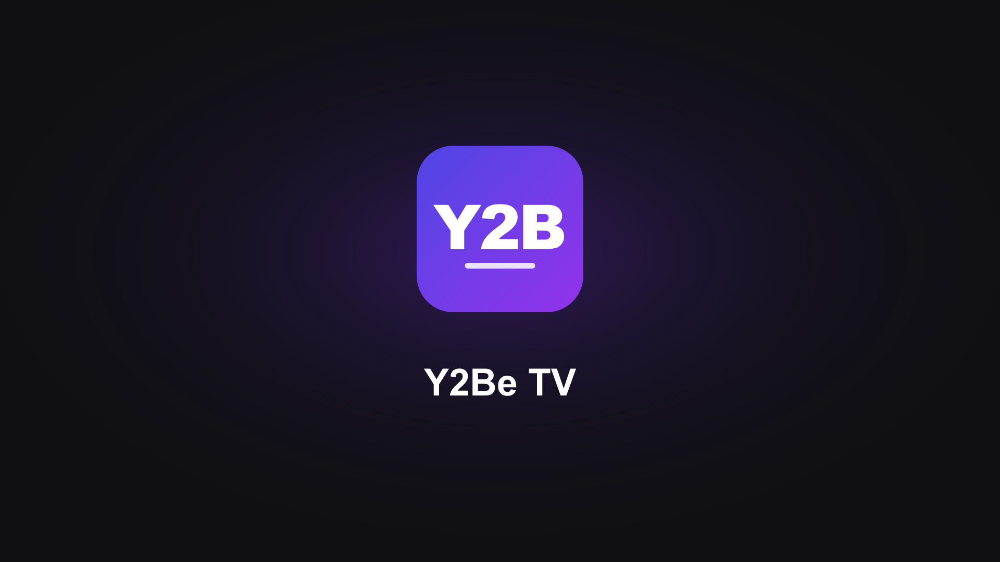

<div align="center">



<p><strong>An alternative YouTube client for LG webOS TVs: no ads, no Shorts, SponsorBlock and remote shortcuts.</strong></p>

[](../../releases)
[](https://steamcommunity.com/id/reptilemk/)
[](https://ko-fi.com/vitalies)
[](LICENSE)

[Download](#download) · [Build it yourself](#build-it-yourself) · [Support](#support-the-project)

</div>

## About

A free, unofficial app for **LG webOS TVs (webOS 4 and newer)** that replaces the YouTube app. It loads YouTube's own TV interface and improves it: it blocks ads, skips sponsor segments with [SponsorBlock](https://sponsor.ajay.app/), hides Shorts and adds shortcuts to the remote's color buttons.

It keeps everything the official app does: the remote's YouTube button, casting from a phone, voice search and your account. Settings are in English or Spanish, following the TV language.

It started as a fork of [webosbrew/youtube-webos](https://github.com/webosbrew/youtube-webos) and is now developed separately, focused on webOS 4+ and kept as small and simple as possible.

## Features

- **No ads.** Video ads, banners, sponsored tiles and promoted Shorts are removed before they load.
- **SponsorBlock built in.** Sponsors, intros, outros, subscribe reminders, self-promotion, non-music parts and recaps are skipped automatically and marked on the progress bar. Every category can be turned on or off.
- **No Shorts.** Gone from home, search, subscriptions and the sidebar.
- **The remote does more:**
  - 🟩 **Green**: settings
  - 🟥 **Red** / 🟨 **Yellow** in a video: jump to the previous / next chapter
  - 🟥 **Red** anywhere else: refresh the page for new recommendations
  - 🟦 **Blue** in a video: audio-only mode
- **Best quality, always.** Forces the highest resolution the video offers.
- **Fewer interruptions.** No end screens and no "who's watching?" screen on startup.
- **Sharper thumbnails**, an on-screen clock and the option to hide the logo.
- **Fast and light.** A small, optimized script built for webOS 4 and newer.
- **Speaks your language.** Settings in English or Spanish, following the TV.
- **Nothing lost from the official app.** The remote's YouTube button, casting from your phone, voice search and your account all keep working.

### Y2Be TV vs. the original

|                                         | youtube-webos        | **Y2Be TV**                       |
| --------------------------------------- | -------------------- | --------------------------------- |
| Ad blocking and SponsorBlock            | ✅                   | ✅                                |
| SponsorBlock on videos with chapters    | ❌ Broken            | ✅                                |
| Skips when you jump into a segment      | ❌                   | ✅                                |
| Correct skips at any playback speed     | ❌                   | ✅                                |
| SponsorBlock settings apply instantly   | ❌ Next video        | ✅                                |
| Hide Shorts                             | Subscriptions only   | **Everywhere, sidebar included**  |
| Jump between chapters with the remote   | ❌                   | ✅                                |
| Refresh recommendations with the remote | ❌                   | ✅                                |
| Settings language                       | English              | **English and Spanish**           |
| Injected script size                    | 274 KB               | **126 KB**                        |
| Progress bar polling during playback    | Every 100 ms         | **Once a second, only if needed** |
| Optimized for webOS 4+                  | ❌ Built for webOS 1 | ✅                                |

## Download

- **Download:** see [Releases](../../releases) and get `youtube.leanback.v4_<version>_all.ipk`.
- **Install:** uninstall the official YouTube app first (this app takes its place), then install the `.ipk` with [webOS Dev Manager](https://github.com/webosbrew/dev-manager-desktop).

## Build it yourself

Don't want to trust a prebuilt package? You can build the exact same `.ipk` from this source.

<details>
<summary>Requirements and build steps</summary>

### Requirements

- [Node.js](https://nodejs.org/) (version in `devEngines` in [package.json](package.json))
- [pnpm](https://pnpm.io/)
- git

### Build

```sh
git clone https://github.com/vitaliesdev/Y2Be-WebOS.git
cd Y2Be-WebOS
pnpm install
pnpm run build
pnpm run package
```

That generates `youtube.leanback.v4_<version>_all.ipk` in the project root (version in `package.json`). Use `pnpm run build:dev` instead of `build` for an unminified build with debug logging.

### Install from the command line

1. On the TV, install the **Developer Mode** app from the LG Content Store, sign in with an [LG Developer account](https://webostv.developer.lge.com/login) and enable _Developer Mode_ and _Key Server_.
2. Add the TV (IP and passphrase are shown in the Developer Mode app): `pnpm exec ares-setup-device`
3. Install, launch and debug with Chrome DevTools: `pnpm run deploy`, `pnpm run launch`, `pnpm run inspect`

### Autostart (rooted TVs)

To have the app show up as an input source and start with the TV, run this on the TV over SSH:

```sh
luna-send-pub -n 1 'luna://com.webos.service.eim/addDevice' '{"appId":"youtube.leanback.v4","pigImage":"","mvpdIcon":""}'
```

To undo it, use `com.webos.service.eim/deleteDevice` with `{"appId":"youtube.leanback.v4"}`.

</details>

## Repository layout

| Path              | What                                                                                                                |
| ----------------- | ------------------------------------------------------------------------------------------------------------------- |
| `src/main.ts`     | Entry point of the script injected into YouTube's TV interface; imports every feature                               |
| `src/launcher/`   | App start page: opens YouTube's TV interface, handling deep links and voice launches                                |
| `src/core/`       | Shared basics: settings, translations, remote color buttons, current page, polyfills                                |
| `src/platform/`   | Hooks into YouTube's TV app: response filters (`json-parse`), its command system (`app-api`) and player (`player/`) |
| `src/features/`   | One file or folder per feature: ad blocking, Shorts, SponsorBlock, chapters, page refresh, video quality, clock...  |
| `src/fixes/`      | webOS compatibility fixes: casting, screensaver, language switch, styles                                            |
| `src/ui/`         | Settings panel, notifications, audio-only mode                                                                      |
| `tests/`          | Unit tests (`pnpm test`, Node's built-in test runner)                                                               |
| `assets/`         | `appinfo.json` (app ID, name), icons and backgrounds                                                                |
| `tools/deploy.js` | Installs the built `.ipk` on the TV                                                                                 |

The app ID stays `youtube.leanback.v4` on purpose: it is what lets the TV route the YouTube button, casting and voice search to this app.

## Support the project

This app is free and made in my spare time. If it saved you from ads or you simply enjoy it, you can help me keep making tools like this.

[](https://ko-fi.com/vitalies)

## Credits

- **Y2Be TV:** REPTIX ([Steam](https://steamcommunity.com/id/reptilemk/))
- Based on [youtube-webos](https://github.com/webosbrew/youtube-webos) by the webOS Homebrew Project contributors (GPL-3.0).
- [SponsorBlock](https://sponsor.ajay.app/) segment data, by Ajay Ramachandran and contributors.
- YouTube is a trademark of Google LLC. This is an unofficial app, not affiliated with or endorsed by Google, YouTube or LG.

## Licence

[GPL-3.0](LICENSE), like the project it is based on.

<div align="center">

[GitHub](https://github.com/vitaliesdev) · [Steam](https://steamcommunity.com/id/reptilemk/) · [Ko-fi](https://ko-fi.com/vitalies)

Made by REPTIX · Vitalie

</div>
